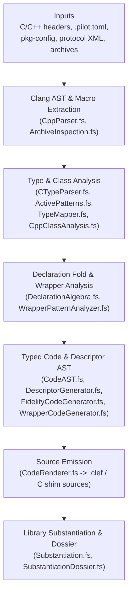

# Farscape

Clef binding generator and boundary substantiation tool for C and C++ libraries in the Fidelity Framework.

[](LICENSE)
[](Commercial.md)

## Overview

Farscape reads C and C++ headers, static archives, pkg-config metadata, and protocol specifications (Wayland and D-Bus XML) to emit `[<FidelityExtern>]` Clef binding declarations, BAREWire companion ABI descriptors, optional Layer 2 Clef wrappers, C ABI shims for C++ surfaces, and library substantiation manifests and dossiers.

Foreign idioms do not cross past Layer 2. Native widths, signedness, calling conventions, parameter passing modes, and ownership rules are recorded in companion BAREWire descriptors rather than leaked into Clef source types. Unsupported boundary shapes fail closed with coded `FS91xx` diagnostics naming the declaration and source location.

Project authority, specifications, and acceptance criteria live on the [Farscape wiki](https://forge.spkez.dev/FidelityFramework/Farscape/wiki) ([Definition of Done](https://forge.spkez.dev/FidelityFramework/Farscape/wiki/Definition-of-Done), [Architectural Decision Ledger](https://forge.spkez.dev/FidelityFramework/Farscape/wiki/Architectural-Decision-Ledger), and [FFI Working Agreements](https://forge.spkez.dev/FidelityFramework/Farscape/wiki/FFI-Working-Agreements)); work items are tracked as [issues](https://forge.spkez.dev/FidelityFramework/Farscape/issues) on milestones.

## Architecture



### Core Modules (`src/Farscape.Core`)

| Module | Responsibility |
|--------|----------------|
| `Diagnostics.fs` | Coded `FS91xx` refusal diagnostics and source-location formatting |
| `AttributeContracts.fs` | Clang attribute and annotation contract extraction |
| `ArchiveInspection.fs` | Symbol and archive inspection for static library provenance |
| `Types.fs` | Core domain model, `OutputMode`, and `PlatformABI` (`LP64`, `LLP64`, `ILP32`, `IP16`) |
| `CppParser.fs` | Clang AST and preprocessor macro extraction |
| `PkgConfig.fs` | Validated `pkg-config` include-path (`-I`, `-isystem`) and define (`-D`) resolution |
| `CTypeParser.fs` / `ActivePatterns.fs` | XParsec parsers and active patterns for C type spellings, qualifiers, macros, and literals |
| `TypeMapper.fs` | `PlatformABI`-parameterized C-to-Clef type mapping |
| `CppClassAnalysis.fs` | C++ class layout, method, constructor/destructor, and C ABI shim analysis |
| `DeclarationAlgebra.fs` | Fold algebra over parsed declarations |
| `PilotTypes.fs` / `PilotDiscovery.fs` / `PilotAnalyzer.fs` / `PilotSerializer.fs` | `.pilot.toml` schema, source-tree asset discovery, prefix scoping, and TOML serialization |
| `ProtocolParser.fs` / `IntrospectionParser.fs` / `TypedProtocolGenerator.fs` / `TypedSignalGenerator.fs` | Wayland/D-Bus XML protocol and signal parsing and typed binding generation |
| `WrapperPatternAnalyzer.fs` / `WrapperCodeGenerator.fs` / `CallbackWrapperGenerator.fs` | Layer 2 result/option wrappers, `ErrnoModuleGenerator.fs`, `EnumErrorModuleGenerator.fs`, and typed callback adapters |
| `CodeAST.fs` / `DescriptorGenerator.fs` / `FidelityCodeGenerator.fs` / `CodeRenderer.fs` | Typed Clef declaration AST, BAREWire `FunctionDescriptor` quotation generation, and source rendering |
| `BindingGenerator.fs` | Single-header and `.pilot.toml` generation orchestration |
| `SubstantiationProof.fs` / `SubstantiationBoundary.fs` / `Substantiation.fs` / `SubstantiationDossier.fs` | Whole-library compiler/proof/seam substantiation and JSON/Markdown/HTML dossier emission |

## CLI Reference

```bash
# Generate bindings from a .pilot.toml manifest
farscape project --project path/to/library.pilot.toml [--wrappers] [--verbose]

# Generate bindings from a single header
farscape generate \
    --header ./scalar-only.h \
    --library c \
    --namespace Fidelity.libc.Scalar \
    --output ./output \
    --output-mode fidelity

# Discover headers/protocols or scaffold a .pilot.toml manifest
farscape pilot discover --directory /path/to/library/source [--library name] [--output ./dir]
farscape pilot analyze --header /usr/include/foo.h --library foo [--pkg-config foo] [--output ./foo]
farscape pilot init --library foo [--header /usr/include/foo.h] [--output ./foo]

# Substantiate an exported library .fidproj and emit a dossier
farscape substantiate \
    --fidproj path/to/Library.fidproj \
    [--pilot path/to/library.pilot.toml] \
    [--link-provenance path/to/link-provenance.toml] \
    [--output ./out]

farscape dossier \
    --manifest path/to/Package.substantiation.json \
    [--seam-checks path/to/seam-checks.json] \
    [--refusal-controls path/to/refusal-controls.json] \
    [--rocq-project path/to/_CoqProject] \
    [--rocq-facts path/to/facts.json] \
    [--output ./out]
```

## Generated Surface and Type Mapping

In `fidelity` mode, Farscape emits `[<FidelityExtern>]` declarations paired with BAREWire `FunctionDescriptor` quotations:

```fsharp
module Fidelity.libc.Scalar

open BAREWire.Hardware
open BAREWire.Descriptors

[<FidelityExtern("c", "abs")>]
let abs (value: int) : int =
    NativeDefault.zeroed ()

let absDescriptor : Expr<FunctionDescriptor> =
    <@ { CName = "abs"
         Parameters = [| { Name = "value"; Type = Integer (Signed, 32); PassBy = Value } |]
         ReturnType = Integer (Signed, 32)
         CallingConvention = CDecl
         OwnershipTransfer = Borrowed } @>
```

Source signatures use Clef types while physical ABI width, signedness, layout, and calling convention are carried in descriptors:

| Foreign Surface | Clef Surface | Boundary Rule |
|-----------------|--------------|---------------|
| C integer scalars and enums | `int` | Signedness and bit width recorded in `FunctionDescriptor` |
| `float` / `double` | `float` | IEEE width recorded in `FunctionDescriptor` |
| Unannotated `T *` or opaque pointer typedef | `option<CHandle<T>>` | Nominal typedef identity preserved; no raw address arithmetic |
| Explicitly nonnull `T *` | `CHandle<T>` | Nonnull contract recorded; does not imply lifetime ownership |
| `void *` | `option<CHandle<unit>>` | User-data and release contracts remain explicit at the boundary |
| `char *` with declared text projection | `option<string>` or `string` | Requires an explicit text-encoding/ownership contract |
| Declared callback pointer | `FnPtr<F>` | Requires complete native signature and supported ABI realization |
| Single-cell out/in-out pointer projection | Clef array with descriptor | Bounds, access mode, and copyback remain explicit obligations |
| Unsupported pointer/callback/variadic contract | None (refused) | Emits coded `FS91xx` refusal diagnostic prior to writing output |

## Build and Test

Run builds and test suites under Bozzetto work leases:

```bash
dotnet fsi ../Bozzetto/tools/build/lease.fsx full_build \
    dotnet build Farscape.sln -c Release --no-incremental

dotnet fsi ../Bozzetto/tools/build/lease.fsx test_suite_run \
    dotnet test tests/Farscape.Tests/Farscape.Tests.fsproj -c Release --no-build
```

## License

Farscape is dual-licensed under the Apache License 2.0 and a Commercial License:

- **Open Source**: Apache License 2.0 ([LICENSE](LICENSE)) for open-source, academic, non-commercial, and internal use.
- **Commercial**: A commercial license is required for incorporating Farscape into commercial products or services; see [Commercial.md](Commercial.md).
- **Patents**: Farscape generates BAREWire descriptors covered by U.S. Provisional Patent Application No. 63/786,247; see [PATENTS.md](PATENTS.md).
