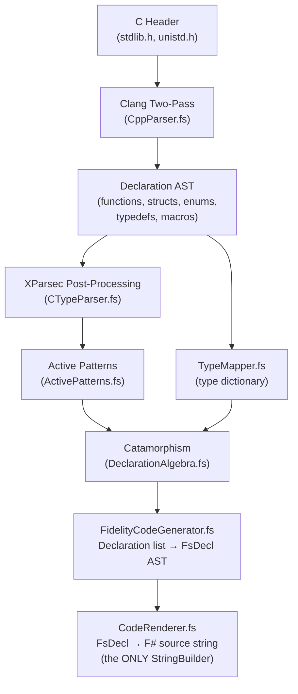

# Farscape

Clef bindings generator for C libraries, part of the Fidelity native compilation ecosystem.

[](LICENSE)
[](Commercial.md)

<p align="center">
Under Active Development<br>
<em>This project is in early development and the API may undergo breaking changes.</em>
</p>

## Overview

Farscape automatically generates Clef bindings from C header files. It uses **clang** for robust header parsing and **XParsec** parser combinators for post-processing C type declarations and preprocessor macro values, producing type-safe Clef code that integrates with the Fidelity native compilation toolchain.

Design documents, the definition of done and the decision ledger live on the
[project wiki](https://forge.spkez.dev/FidelityFramework/Farscape/wiki); every work item is an
[issue](https://forge.spkez.dev/FidelityFramework/Farscape/issues) on a milestone.

The [2026-10-03 FFI checkpoint](https://forge.spkez.dev/FidelityFramework/Farscape/wiki/History-20261003-ffi-boundary-checkpoint)
records the completed pointer-surface correction, **649/649** source tests and
**17/17** generator/compiler conformance gates. Generation uses nominal
`CHandle` carriers, conservative nullability and typed `FnPtr` declarations.
Native callback ABI publication and general foreign resource lifetimes remain
incomplete; unsupported contracts are refused. Existing desktop libraries have
not been regenerated or accepted wholesale by this checkpoint.

The codebase is structured around four functional programming patterns that compose cleanly:

- **XParsec Parser Combinators** (`CTypeParser.fs`): Monadic parsers decompose C type declarations (`const char *` → `{ BaseType = "char"; PointerDepth = 1 }`), classify preprocessor macro values, and parse numeric literals, replacing all Regex usage
- **Active Patterns** (`ActivePatterns.fs`): XParsec-backed active patterns (`ParsedCType`, `CharPointer|VoidPointer|TypedPointer|ValueType`, `CompilerBuiltin|InternalMacro|UserMacro`, `IntegerLiteral`) provide structural decomposition at match sites
- **Catamorphism** (`DeclarationAlgebra.fs`): A fold algebra over the Declaration DU; one traversal function serves typedef extraction, function collection, and full code generation through composable algebras
- **Typed Code AST** (`CodeAST.fs` → `CodeRenderer.fs`): Generation produces `FsDecl` values (typed, inspectable, testable AST nodes), not strings. The ONLY `StringBuilder` in the codebase is the final `CodeRenderer.render`

Farscape is a key tool for the [Fidelity Framework](https://github.com/FidelityFramework) native Clef compilation ecosystem.

## Architecture



### Functional Patterns in Action

**XParsec parser** decomposes a C type declaration:

```fsharp
// CTypeParser.fs: monadic parser for C types
static let pCType =
    parser {
        do! skipMany pQualifier          // strip const, restrict, volatile
        let! firstWord = pTypeWord       // "unsigned"
        let! restWords = many (spaces1 >>. pTypeWord)  // "long", "int"
        let! stars = many (skipChar '*') // pointer depth
        return { BaseType = baseType; PointerDepth = stars.Length }
    }
```

**Active patterns** classify native spellings. Generation then resolves typedef
identity and nullability before selecting a sanctioned Clef carrier. A native
data pointer becomes `CHandle<T>` or `option<CHandle<T>>`; a declared text
projection can expose Clef `string`. Native widths remain descriptor facts.

**Catamorphism** folds an algebra over all declarations in one pass:

```fsharp
// DeclarationAlgebra.fs: single traversal, composable algebras
let groups = cataDeclarations (generationAlgebra typedefMap) declarations
// One pass produces: enums, structs, functions, macros, all categorized
```

**Typed AST** separates generation from rendering:

```fsharp
// CodeAST.fs: typed nodes, not strings
LetBinding("abs",
    [{ Name = "value"; Type = Named "int" }],
    Named "int",
    NativeZeroed,
    ["FidelityExtern(\"c\", \"abs\")"])
// CodeRenderer.fs renders to Clef source (the ONLY StringBuilder)
```

### Core Modules

| Module | Purpose |
|--------|---------|
| `Types.fs` | Shared types: `OutputMode`, `PlatformABI` (LP64/LLP64/ILP32/IP16) |
| `CppParser.fs` | Clang two-pass parsing: JSON AST + macro extraction |
| `TypeMapper.fs` | NTU type dictionary: C types → Clef types, PlatformABI-parameterized |
| `CTypeParser.fs` | XParsec parsers for C type strings, macro values, numeric literals |
| `ActivePatterns.fs` | Type classification, macro filtering, keyword quoting via active patterns |
| `DeclarationAlgebra.fs` | Catamorphism: fold algebra over Declaration DU |
| `CodeAST.fs` | Typed code AST: `FsType`, `FsExpr`, `FsDecl` discriminated unions |
| `CodeRenderer.fs` | Single renderer: `FsDecl → string` (only StringBuilder in the codebase) |
| `FidelityCodeGenerator.fs` | Fidelity mode: catamorphism → FsDecl tree → rendered source |
| `WrapperPatternAnalyzer.fs` | Layer 2: clang attribute analysis → return semantic + parameter role classification |
| `WrapperCodeGenerator.fs` | Layer 2: idiomatic Clef wrapper generation with Result types |
| `ErrnoModuleGenerator.fs` | Header error constants/descriptions and opaque errno-cell declaration; dereference wrappers are refused |
| `PilotAnalyzer.fs` | Namespace filtering and declaration scoping from project files |
| `PilotSerializer.fs` | TOML project file parsing (`.pilot.toml`) |
| `BindingGenerator.fs` | Pipeline orchestration for single-header and project-based generation |

## Usage

```bash
# Generate from a curated Linux C pilot (the output path is relative to the pilot)
farscape project --project path/to/library.pilot.toml --verbose

# Generate declarations from a header containing: int abs(int value);
farscape generate \
    --header ./scalar-only.h \
    -l c \
    -m fidelity \
    -n Fidelity.libc.Scalar \
    -o ./output/

Options:
      --header <header>         Path to C header file (required)
  -l, --library <library>       Name of native library (required)
  -o, --output <output>         Output directory [default: ./output]
  -n, --namespace <namespace>   Namespace for generated code [default: NativeBindings]
  -i, --include-paths <paths>   Additional include paths
  -d, --defines <defines>       Preprocessor definitions
  -m, --output-mode <mode>      Output mode: fidelity | fidelity-wrappers [default: fidelity]
  -v, --verbose                 Verbose output
```

The `project` command accepts `--project`, `--verbose` (`-v`) and optional
`--wrappers` (`-w`). The CLI currently selects LP64 and project manifests declare
Linux x86_64; there is no CLI `--data-model` option. Wrapper selection can be
refused when errno access, native error text, a callback adapter or another
required contract is missing. See the checkpoint for regeneration and validation.

## Output Modes

### Fidelity Mode (`--output-mode fidelity`)

Generates `[<FidelityExtern>]` declarations with companion ABI descriptors. The
accepted scalar example uses ordinary Clef integers while declaring C's width:

```fsharp
module Fidelity.libc.Scalar

open BAREWire.Hardware
open BAREWire.Descriptors

[<FidelityExtern("c", "abs")>]
let abs (value: int) : int =
    NativeDefault.zeroed ()

let absDescriptor : Expr<FunctionDescriptor> =
    <@ { CName = "abs"
         Parameters = [| { Name = "value"; Type = Integer (Signed, 32); PassBy = Value } |]
         ReturnType = Integer (Signed, 32)
         CallingConvention = CDecl
         OwnershipTransfer = Borrowed } @>
```

## Type Mapping

Source signatures use Clef `int` and `float`. Native signedness, storage width,
pointer width and calling convention belong to descriptors resolved from the
selected ABI model. Analysis supports LP64, LLP64, ILP32 and IP16; current project
generation accepts Linux x86_64 LP64 and refuses a different model before writes.

| C Type | Clef Type | Notes |
|--------|-----------|-------|
| C integer scalars and enums | `int` | Signedness and native width come from the descriptor |
| `float` / `double` | `float` | Native floating representation comes from the descriptor |
| Unannotated `T *` or opaque pointer typedef | `option<CHandle<T>>` | Nominal typedef identity is preserved; no pointer operations |
| Explicitly nonnull data pointer | `CHandle<T>` | Nonnull is not a lifetime or validity proof |
| `void *` | `option<CHandle<unit>>` by default | Typed user-data and release obligations remain at the boundary |
| `char *` with a text-input projection | `option<string>` or `string` | Requires the declared text conversion contract |
| Declared callback | `FnPtr<F>` in a typed entry record | Complete native signature and supported ABI realization required |
| Nullable foreign callback result or nested slot | Refused when its adapter is unsupported | Absence must not be changed into a nonnull assertion |
| Declared single-cell reference projection | Clef array with descriptor | Native representation, bounds, access and copyback remain obligations |

Type mapping uses XParsec-backed active patterns and typedef chain resolution.
It does not expose a source integer address or an alternate raw pointer surface.

## Validated Output

The final source suite passed **649/649**. The durable
[BoundaryConformance driver](tests/BoundaryConformance/README.md) passed **17/17**
gates using actual parsed headers and current-source Clef. It checks reachable
scalar admission, nominal/nullable generated contracts and exact unsupported
boundary diagnostics. It performs no native execution. Accepted hashes and local
evidence paths are recorded in the checkpoint.

## Testing

```bash
# Run the test suite
cd tests/Farscape.Tests && dotnet test

# Tests cover:
#   - CTypeParser: XParsec parsers for C types, macros, integers, arrays
#   - ActivePatterns: Type decomposition, macro classification, keyword quoting
#   - DeclarationAlgebra: Catamorphism, typedef/struct extraction, order preservation
#   - CodeRenderer: FsDecl → Clef source for all declaration types
#   - FidelityCodeGenerator: End-to-end declaration → source generation
#   - WrapperCodeGenerator: Layer 2 wrapper pattern generation
#   - ErrnoModuleGenerator: Header descriptions and opaque errno contract
#   - PilotAnalyzer/PilotSerializer: Namespace analysis and TOML project round-trip
#   - Platform ABI: LP64/LLP64/ILP32/IP16 type width resolution
```

## License

Farscape is dual-licensed under both the Apache License 2.0 and a Commercial License.

### Open Source License

For open source projects, academic use, non-commercial applications, and internal tools, use Farscape under the **Apache License 2.0**.

### Commercial License

A Commercial License is required for incorporating Farscape into commercial products or services. See [Commercial.md](Commercial.md) for details.

### Patent Notice

Farscape generates BAREWire peripheral descriptors, which utilize technology covered by U.S. Patent Application No. 63/786,247 "System and Method for Zero-Copy Inter-Process Communication Using BARE Protocol". See BAREWire's [PATENTS.md](https://github.com/speakeztech/barewire/blob/main/PATENTS.md) for licensing details.
